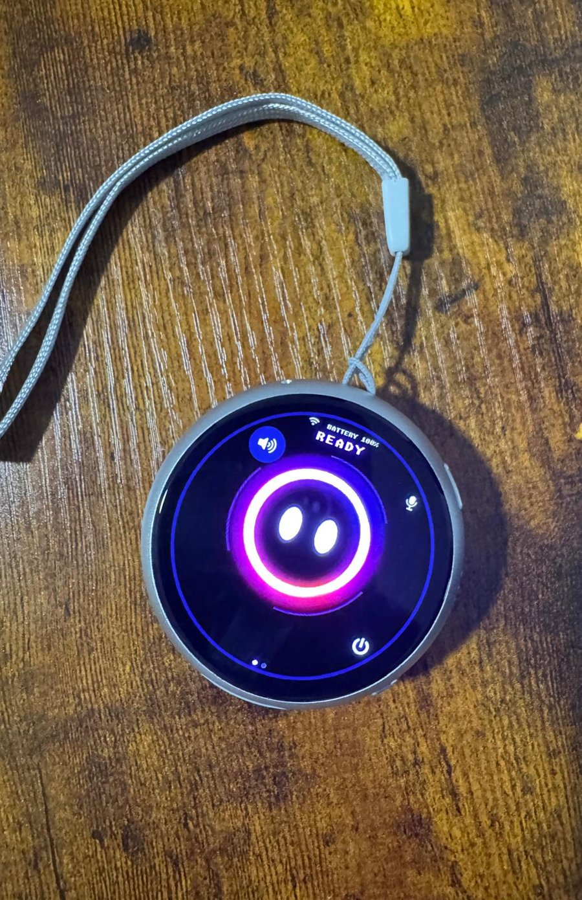
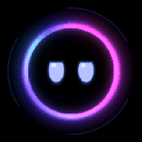
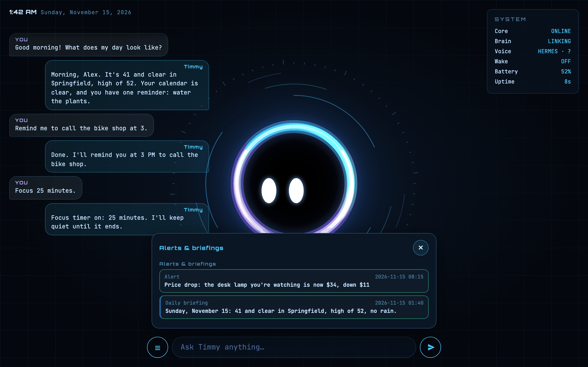
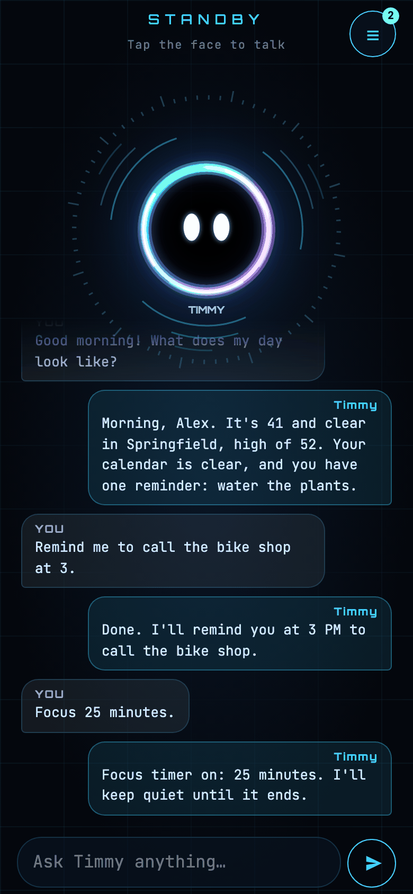
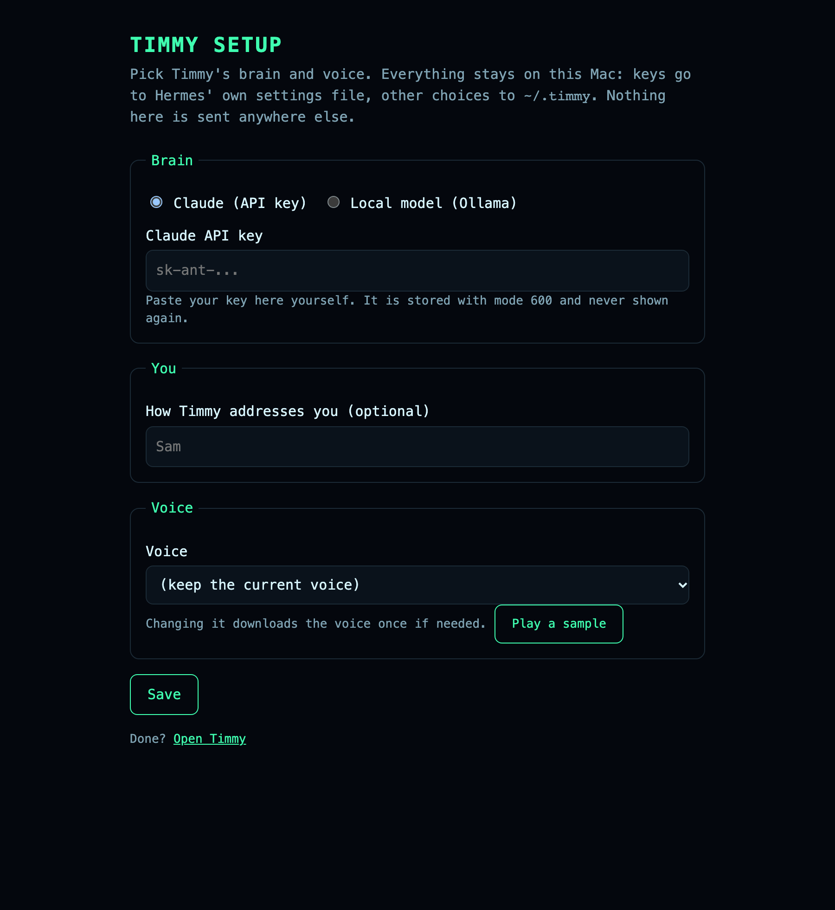

# Timmy (TimmyAI)

**A $42 desk buddy with neon eyes that you can talk to.** Hold the button, ask
anything, and Timmy answers out loud while its eyes listen, think and react.
The brain runs on your own Mac, so it's private by default.

  
  &nbsp;&nbsp;
  

## Meet the desk gadget

Timmy lives on a palm-sized round AMOLED board on your desk:

- **Hold to talk.** Press the top button, ask, let go. Timmy answers through
  its built-in speaker.
- **Eyes with moods.** They listen, think, speak, get happy when you pet the
  screen, react when you poke, tilt or shake it, and get sleepy at night.
- **Desk skills that show on the eyes.** A focus timer with a countdown ring,
  weather the eyes react to, reminders that glow and nudge, quick notes, and a
  morning briefing.
- **Never loses a question.** Ask while it's offline and it saves the question
  and answers as soon as it's back.
- **Yours to change.** New moods, faces and skills are plain files. See
  [docs/CUSTOMIZING.md](docs/CUSTOMIZING.md).

### Moods

| Idle | Listening | Thinking | Speaking |
|------|-----------|----------|----------|
|  |  |  |  |

| Happy (petted) | Sleepy | Focus timer |
|----------------|--------|-------------|
|  |  |  |

### Get one

You need the Waveshare **ESP32-S3-Touch-AMOLED-1.75C** (about $42): a 1.75"
round AMOLED touch board in an aluminum case with a speaker, microphones and an
optional battery. Make sure it's the **1.75C** (with case); the plain 1.75 board
is different. Add a USB-C *data* cable.

- [Buy it from Waveshare](https://www.waveshare.com/esp32-s3-touch-amoled-1.75c.htm)
- [Waveshare docs for the board](https://docs.waveshare.com/ESP32-S3-Touch-AMOLED-1.75C)

Then run `./install.sh` and `./install.sh flash` (see [Install](#install)).

## How it works

- **Brain**: [Hermes Agent](https://hermes-agent.nousresearch.com) on your Mac,
  with Claude (your own API key) or a free local model (Ollama).
- **Voice**: local speech-to-text (Whisper) and text-to-speech (Piper or
  Kokoro), so audio stays on your Mac.
- **Desk gadget**: firmware in `firmware/` for the Waveshare board.
- **Web and phone**: the same Timmy on a web page and a phone home-screen app
  on your own network. No board yet? Try it there first.

Your personal data never lives in this repository: it is in `~/.timmy`
(`TIMMY_HOME`). See [docs/CUSTOMIZING.md](docs/CUSTOMIZING.md).

## Also on your Mac and phone

| Menu | Alerts & briefings | Voice & speed |
|------|--------------------|---------------|
|  |  |  |

| On a phone | First-run setup |
|------------|-----------------|
|  |  |

## Install

On macOS:

    git clone https://github.com/sandeeplakshmi/TimmyAI.git Timmy && cd Timmy
    ./install.sh

It checks and installs what's missing (Homebrew, Python, Hermes Agent, a
voice), creates `~/.timmy` from templates (an existing one is left as it is),
sets up the login service and opens the first-run setup page, where you enter
your Claude API key (or pick a local model) and a voice. Re-running it is safe.

    ./install.sh doctor        # what's working, what isn't and how to fix it (--json for tools)
    ./install.sh flash         # guided firmware flash for the desk gadget

Options: `--yes` (no questions), `--dry-run`, `--json`, `--no-services`, `--no-open`,
`--with-firmware-tools` (ESP-IDF, only to build firmware). New Mac with an
existing backup of your `~/.timmy`? See [docs/RESTORE.md](docs/RESTORE.md).

### Install with an AI assistant

Paste this into Claude Code, Codex, Cursor, Copilot or Gemini CLI, in an empty
folder:

> Install Timmy from https://github.com/sandeeplakshmi/TimmyAI on this Mac. Follow AGENTS.md, run
> ./install.sh --yes, then ./install.sh doctor, fix anything it reports, and
> stop to ask me before flashing the board.

The assistant never handles your API key: the install ends on the local setup
page, where you paste it yourself.

## Build and flash the gadget

Build and flash: [firmware/README.md](firmware/README.md), or just
`./install.sh flash` (it finds the board on USB, flashes, then waits for it to
join Wi-Fi and reach the server).

## Layout

| Path | What |
|------|------|
| `firmware/` | ESP-IDF firmware for the desk gadget |
| `server/` | the web server and gadget endpoint (Python), local skills, brain skills, login-service scripts |
| `web/` | the web page and first-run setup page |
| `templates/timmy-home/` | what a new `~/.timmy` starts with |
| `scripts/` | installer helpers, flashing, doctor, backup/restore, license and private-data checks |
| `docs/` | customizing, releasing, restoring |

## Safety rails

`scripts/install-hooks.sh` installs a pre-commit hook that blocks secrets
(gitleaks), your private strings (`~/.timmy/denylist.txt`), new files without a
license header, and third-party branding. CI runs the same checks
(`.github/workflows/checks.yml`). Release checklist:
[docs/RELEASING.md](docs/RELEASING.md).

## Credits and license

Timmy is licensed under the Apache License 2.0 (`LICENSE`). The firmware is
based on the Muse Gadgets SDK by Meta Platforms, Inc. and affiliates (Apache
License 2.0), modified; see `NOTICE` for that attribution and the bundled
third-party components. Timmy is an independent project, not affiliated with
or endorsed by Meta.
