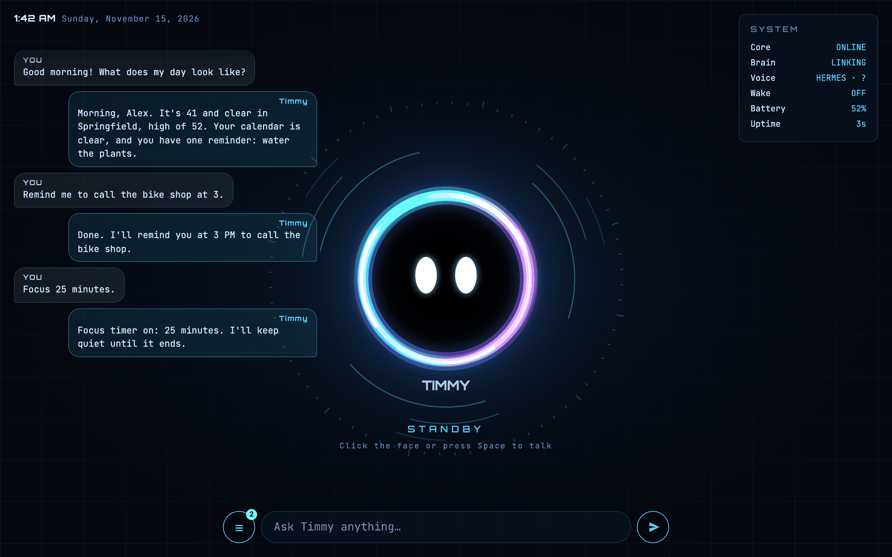
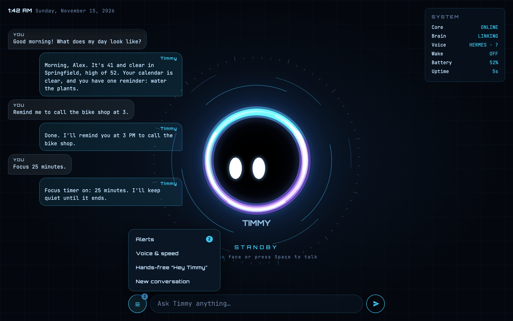
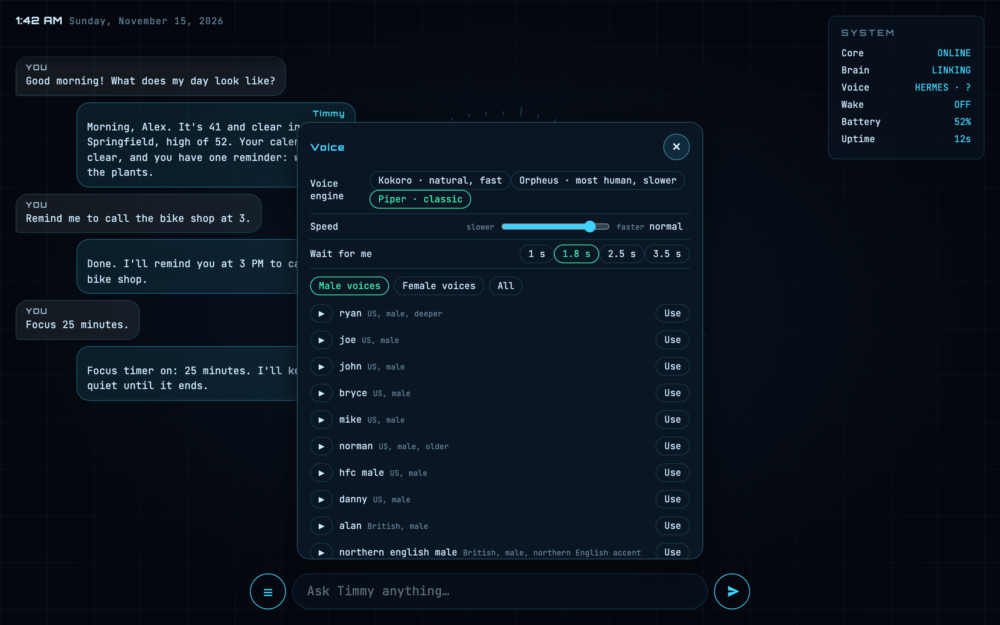

# Timmy (TimmyAI)

A personal voice assistant that runs on your own Mac, with a little round desk
gadget to talk to it. Hold the button, ask, and Timmy answers out loud with
animated neon eyes. The same assistant is on a web page (with a phone-friendly
home-screen app) on your own network.

- **Brain**: [Hermes Agent](https://hermes-agent.nousresearch.com) with Claude
  (API key) or a local model (Ollama).
- **Voice**: local speech-to-text (Whisper) and text-to-speech (Piper or Kokoro)
  through Hermes, so audio stays on your Mac.
- **Desk gadget**: firmware for the Waveshare ESP32-S3-Touch-AMOLED-1.75C.
- **Skills**: fast local skills (focus timer, weather, reminders, notes, desk
  buddy, morning briefing) plus brain skills (research, DIY plans, Mac control,
  voices).

Your personal data never lives in this repository: it is in `~/.timmy`
(`TIMMY_HOME`). See [docs/CUSTOMIZING.md](docs/CUSTOMIZING.md).

## Screenshots

The web page :

| Menu | Alerts & briefings | Voice & speed |
|------|--------------------|---------------|
|  |  |  |

| On a phone | First-run setup |
|------------|-----------------|
|  |  |

### The desk gadget

<!-- BOARD VIDEO: add a real photo/video of the board here (shot list: docs/media/README.md), e.g.

-->
*A photo and video of the real board are coming; see the shot list in [docs/media/README.md](docs/media/README.md).*

### Moods

| Idle | Listening | Thinking | Speaking |
|------|-----------|----------|----------|
|  |  |  |  |

| Happy (petted) | Sleepy | Focus timer |
|----------------|--------|-------------|
|  |  |  |

## Install

On macOS:

    git clone https://github.com/sandeeplakshmi/TimmyAI.git Timmy && cd Timmy
    ./install.sh

It checks and installs what's missing (Homebrew, Python, Hermes Agent, a
voice), creates `~/.timmy` from templates (an existing one is left as it is),
sets up the login service and opens the first-run setup page, where you enter
your Claude API key (or pick a local model) and a voice. Re-running it is safe.

    ./install.sh doctor        # what's working, what isn't and how to fix it (--json for tools)
    ./install.sh flash         # guided firmware flash for the desk gadget

Options: `--yes` (no questions), `--dry-run`, `--json`, `--no-services`, `--no-open`,
`--with-firmware-tools` (ESP-IDF, only to build firmware). New Mac with an
existing backup of your `~/.timmy`? See [docs/RESTORE.md](docs/RESTORE.md).

### Install with an AI assistant

Paste this into Claude Code, Codex, Cursor, Copilot or Gemini CLI, in an empty
folder:

> Install Timmy from https://github.com/sandeeplakshmi/TimmyAI on this Mac. Follow AGENTS.md, run
> ./install.sh --yes, then ./install.sh doctor, fix anything it reports, and
> stop to ask me before flashing the board.

The assistant never handles your API key: the install ends on the local setup
page, where you paste it yourself.

## The desk gadget

Build and flash: [firmware/README.md](firmware/README.md), or just
`./install.sh flash` (it finds the board on USB, flashes, then waits for it to
join Wi-Fi and reach the server).

## Layout

| Path | What |
|------|------|
| `firmware/` | ESP-IDF firmware for the desk gadget |
| `server/` | the web server and gadget endpoint (Python), local skills, brain skills, login-service scripts |
| `web/` | the web page and first-run setup page |
| `templates/timmy-home/` | what a new `~/.timmy` starts with |
| `scripts/` | installer helpers, flashing, doctor, backup/restore, license and private-data checks |
| `docs/` | customizing, releasing, restoring |

## Safety rails

`scripts/install-hooks.sh` installs a pre-commit hook that blocks secrets
(gitleaks), your private strings (`~/.timmy/denylist.txt`), new files without a
license header, and third-party branding. CI runs the same checks
(`.github/workflows/checks.yml`). Release checklist:
[docs/RELEASING.md](docs/RELEASING.md).

## Credits and license

Timmy is licensed under the Apache License 2.0 (`LICENSE`). The firmware is
based on the Muse Gadgets SDK by Meta Platforms, Inc. and affiliates (Apache
License 2.0), modified; see `NOTICE` for that attribution and the bundled
third-party components. Timmy is an independent project, not affiliated with
or endorsed by Meta.
